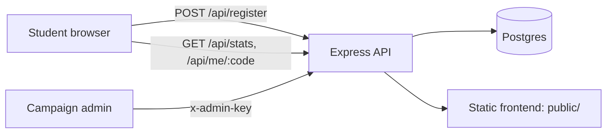

# AI Workshop Registration Engine

A registration and growth-tracking site for **"Build Your First AI Project in 60 Minutes"**, a free workshop for final-year engineering students. It was built for the NxtWave growth challenge: get 500 registrations in 7 days on a budget of Rs 2,000.

   

**Preview (prototype, browser-only storage):** https://claude.ai/artifact/QKCtquNruJSDnTvP7uCT2S
**Live site (Render):** `https://<your-service>.onrender.com`

[](https://render.com/deploy?repo=https://github.com/<your-username>/<your-repo>)

---

## The problem

Final-year students are in placement season with resumes full of tutorial clones, and interviewers now ask what they have built with AI. A free, 60-minute, outcome-driven workshop is an easy yes. The hard part is reaching them cheaply and making each registration bring in more.

## The growth plan

| Channel | Action | Projected registrations |
|---|---|---|
| Club leads and T&P cells | Personalised outreach to ~150 leads. About 50 forward it into groups of ~180 students at ~2.5% conversion. | ~230 |
| NxtWave's own audience | Email, WhatsApp broadcast and one LinkedIn/Instagram post. | ~140 |
| Referral loop | Every registrant gets a code. 3 referrals unlock a Starter Kit, and the top 5 referrers split a Rs 1,000 prize pool. | ~150 |
| Paid shoutouts | Rs 600 on 2-3 college meme and tech pages. | ~40 |
| **Total (planned)** | | **~560** (12% buffer over 500) |

**Budget:** Rs 1,000 referral prizes, Rs 600 shoutouts, Rs 400 reserve. Everything else uses free tools.

These are planning estimates based on stated assumptions (existing NxtWave audience, typical group-post conversion rates). They are not results.

## What I built

- **Landing page and registration form.** A 60-minute run-sheet as the hero, a live seat counter, and server-side validation (Indian mobile format, duplicate-number blocking).
- **Referral engine.** Each student gets a unique 6-character code and a shareable link (`/?ref=CODE`). A progress bar tracks friends joined toward the Starter Kit.
- **Source attribution.** Links tagged `?src=club`, `?src=group`, `?src=faculty`, `?src=nxtwave` or `?src=social` record which channel each registration came from.
- **Admin tracker.** Registrations against the 500 goal, a breakdown by source, a referral leaderboard with prize amounts, top colleges, and CSV export. It is protected by an admin key.
- **WhatsApp outreach kit.** Ready-to-send messages for club leads, student groups and professors, with the right tracked link filled in.

## Architecture



**Stack:** Node.js 18+, Express, PostgreSQL (`pg`), vanilla HTML/CSS/JS. There is no build step, which keeps deploys fast and the code easy to read.

**Storage:** Postgres on Render (`DATABASE_URL`). If that variable is not set, the server falls back to a local `data.json` so the project runs with zero setup.

## API

| Method | Endpoint | Auth | Description |
|---|---|---|---|
| GET | `/healthz` | none | Health check for Render |
| GET | `/api/stats` | none | `{ count }` for the seat counter |
| GET | `/api/me/:code` | none | `{ name, code, referrals }` for a returning student |
| POST | `/api/register` | none | Body: `name, phone, college, branch, source, ref, utm`. Returns `{ name, code, referrals, count }` |
| GET | `/api/admin/regs` | `x-admin-key` | All registrations (phone numbers excluded) |
| GET | `/api/admin/export` | `x-admin-key` | CSV export including phone numbers |

## Data model

`regs(id, name, phone UNIQUE, college, branch, source, ref, code UNIQUE, created)`

- `ref` holds the referrer's code, so the referral count is the number of rows where `ref = code`.
- Source precedence: a valid referral code wins, then the `?src=` tag, then the form's "how did you hear" answer.

## Security and reliability

- Admin routes use a constant-time key comparison (`crypto.timingSafeEqual`).
- All user input is trimmed, length-limited and validated server-side. The frontend escapes everything it renders.
- CSV export neutralises spreadsheet formula injection (cells starting with `=`, `+`, `-` or `@`).
- A per-IP rate limit (60 registrations per hour) protects the form.
- Unique constraints on `phone` and `code` stop duplicate registrations even under simultaneous requests.
- Phone numbers are never returned by public endpoints or the admin JSON list.

## Run locally

```bash
npm install
ADMIN_KEY=test node server.js     # http://localhost:3000, stores data in data.json
```

## Deploy on Render

1. Push this repo to GitHub.
2. In Render, choose **New > Blueprint**, select the repo and click **Apply**. `render.yaml` creates the web service and a free Postgres database.
3. Copy the generated `ADMIN_KEY` from the service's **Environment** tab and use it on the **Tracker (admin)** tab.
4. Share campaign links such as `https://<your-service>.onrender.com/?src=club`.

On Render's free plan the web service sleeps after about 15 minutes idle (the first load takes ~50 seconds), and the free database expires after 30 days. Open the site before each outreach wave and download the CSV before the database expires.

## Design decisions and trade-offs

- **Vanilla JS and Express instead of a framework.** The app is small and needs to load fast on student phones and weak networks, so I kept the page light and added no build step.
- **Referral code in the URL.** The code travels in the link, so a friend lands on the form with it prefilled. This removes the main drop-off point in referral flows.
- **Postgres over a spreadsheet.** Unique constraints give reliable duplicate protection, and the data is easy to query. The CSV export covers the moment someone wants it in Sheets.
- **Application-side counting.** The API loads rows and counts in memory. This is fine for the thousands of rows this campaign produces, and simpler to reason about than extra queries.

## Limitations and next steps

- Phone numbers are not verified (no OTP), so fake numbers are possible.
- The rate limiter is in memory and resets on restart. A multi-instance setup would need Redis.
- Testing so far is a manual smoke test with `curl`. Automated API tests are the next addition.
- Next: automated WhatsApp reminders 24 hours and 1 hour before the session (WhatsApp Business API), a live engagement tool for the workshop itself, and automated evaluation of the projects students submit.

## Project structure

```
.
├── server.js        # API, validation, storage, admin routes
├── public/
│   ├── index.html   # Landing page, tracker and outreach kit
│   └── app.js       # Frontend logic
├── render.yaml      # Render Blueprint (web service + Postgres)
└── package.json
```

## About this project

Built as a one-week growth simulation. I planned the campaign and built the app with AI assistance (Claude), then reviewed, tested and adjusted the output myself. No outreach was executed and no real student data was collected.

**Author:** `<Your Name>` | `<LinkedIn URL>` | `<email>`
